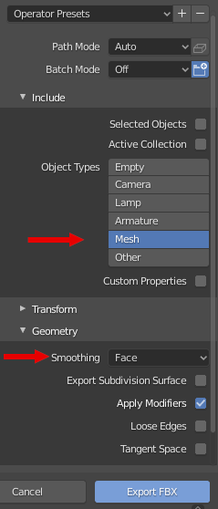

# Hybrid 3D Gaussian Splatting and LiDAR Reconstruction 
<!-- Add later to aurova_preprocessed -->
This repository has the methods to generate the 3D Hybrid Reconstructions of the paper "Sim-to-Real Transfer by Hybrid 3D Gaussian Splatting and LiDAR Reconstruction for Autonomous Driving".

## Installation
For retrieving the mesh from LiDAR point clouds, install the migrated version of [ImMesh](https://github.com/Aleoli2/ImMesh) to ROS 2 Jazzy:
```
sudo apt-get install ros-jazzy-cv-bridge ros-jazzy-tf ros-jazzy-message-filters ros-jazzy-image-transport*
sudo apt-get install -y libcgal-dev pcl-tools
sudo apt-get install -y libgl-dev libglm-dev libglfw3-dev libglew-dev libglw1-mesa-dev 
sudo apt-get install -y libcgal-dev libxkbcommon-x11-dev

cd PATH/TO/aurova_ws/src
git clone https://github.com/Aleoli2/livox_ros_driver2.git
git clone https://github.com/Aleoli2/ImMesh.git --branch ros2
cd ../
colcon build --symlink-install --cmake-args -DCMAKE_BUILD_TYPE=Release --packages-up-to im_mesh
chmod +x PATH/TO/aurova_ws/src/ImMesh/launch/record_bag.sh
source install/setup.bash
```

This version has the launch file `mapping_ouster.launch` that also saves the trajectory, if using other sensor configuration use it as template for generating the mesh. Also, install follow the library [evo](https://github.com/MichaelGrupp/evo):
```
pip install evo
```

For optimizing the 3D Gaussian Splatting models, several SOTA methods have been used, building Docker images for each of them. Clone this repository:
```
git clone --recurse-submodules https://github.com/AUROVA-LAB/aurova_reconstruction.git --branch ros2
```
To build the Docker images, change the CUDA_ARCHITECTURES and TORCH_CUDA_ARCH_LIST in the next instructions to the architecture of your GPU.
### 1. COLMAP
A Docker image is build for the versions of [COLMAP](https://github.com/colmap/colmap) and [GLOMAP](https://github.com/colmap/glomap) that allow pose prior information. To build the image, edit the CUDA_ARCHITECTURES in build.sh and run:
```
cd hybrid_3dgs_mesh/submodules/colmap/docker
./build.sh
```

### 2. [Octree-GS](https://city-super.github.io/octree-gs/)
```
cd hybrid_3dgs_mesh/submodules/Octree-GS
docker build --build-arg TORCH_CUDA_ARCH_LIST="8.9" --build-arg CUDA_ARCHITECTURES="89" -t aurova_octree_gs .
```

### 3. [Gaussian Opacity Fields](https://niujinshuchong.github.io/gaussian-opacity-fields/)
```
cd hybrid_3dgs_mesh/submodules/gaussian-opacity-fields
docker build --build-arg TORCH_CUDA_ARCH_LIST="8.9" --build-arg CUDA_ARCHITECTURES="89" -t aurova_gof .
```

### 4. [Hierarchical-3DGS](https://repo-sam.inria.fr/fungraph/hierarchical-3d-gaussians/)
```
cd hybrid_3dgs_mesh/submodules/hierarchical-3d-gaussians
docker build --build-arg TORCH_CUDA_ARCH_LIST="8.9" --build-arg CUDA_ARCHITECTURES="89" -t aurova_hierarchical3dgs .
```

## Extract the mesh
Firstly, record a rosbag of the desired scene, saving the images and the LiDAR point clouds (we saved front-view depth images and reconstruct the point cloud from them to reduce storage usage). Save the rosbag directory as `scene_bag` in the directory for your dataset, and then run:

```
cd hybrid_3dgs_mesh/data_utils
export DATASET_DIR=your_path_to_dataset
python prepare_ROS_data.py --rosbag ${DATASET_DIR}/scene_bag --output ${DATASET_DIR}
```

This script extracts the images from the rosbag and name them respect their timestamp. There are some arguments to specify the name of the topics, skip some initial frames or specify the resolution of the images. Then, set the rosbag path in the ImMesh launch file and run it:
```
ros2 launch im_mesh mapping_ouster.launch 
```
Use the ImMesh GUI to save the mesh. Then, copy the generated rosbag in `PATH/TO/aurova_ws/src/ImMesh/Log` to `${DATASET_DIR}/immesh_bag`. Extract the pose priors of the images using both rosbags:
```
python get_pose_prior.py --rosbag_path ${DATASET_DIR}/immesh_bag --rosbag_images ${DATASET_DIR}/scene_bag --images_folder ${DATASET_DIR}/images/ --output ${DATASET_DIR}
```

For adding the meshes to CARLA simulator, transform the output `.ply` to `.fbx`. We used Blender to import them and export them, including only the mesh in Object Types and smoothing the Faces in Geometry, and leave the other parameters as default.


## Obtain the camera poses
Run the Docker image in other terminal to perform the Structure-from-Motion (SfM):
```
export DATASET_DIR=your_path_to_dataset
xhost +local:
docker run --rm --gpus all --ipc=host --ulimit memlock=-1 --ulimit stack=67108864 -it --net=host --privileged -e DISPLAY=$DISPLAY -v /tmp/.X11-unix:/tmp/.X11-unix:rw -v /dev:/dev -v ${DATASET_DIR}:/workspace -v PATH/TO/hybrid_3dgs_mesh:/hybrid_3dgs_mesh colmap
```

Extract the features:
```
cd /hybrid_3dgs_mesh/data_utils
./preprocess_colmap.sh
```

Run the SfM using COLMAP or GLOMAP in the Docker terminal:

1. COLMAP
```
cd /workspace
colmap pose_prior_mapper --database_path colmap/database.db --image_path images/ --output_path sparse/
```
Check the result with `colmap gui`. If the reconstruction is incorrect, there are some arguments that may improve the result.
```
colmap pose_prior_mapper --database_path colmap/database.db --image_path images/ --output_path sparse/ --prior_position_std_x 0.5 --prior_position_std_y 0.5 --prior_position_std_z 0.5 --overwrite_priors_covariance 1
```
COLMAP may generate several reconstructions. Move the correct one to `sparse/0`.

2. GLOMAP
```
cd /workspace
glomap mapper --database_path colmap/database.db --image_path images/ --output_path sparse/ --PosePrior.use_pose_position_prior 1 --PosePrior.prior_position_std_x 0.5 --PosePrior.prior_position_std_y 0.5 --PosePrior.prior_position_std_z 0.5 --PosePrior.overwrite_priors_covariance 1 --PosePrior.use_robust_loss_on_prior_position 1 
```
The prior_position_std can be tune if the reconstruction is incorrect, or you can use the version without pose prior.
```
glomap mapper --database_path colmap/database.db --image_path images/ --output_path sparse/
```
---

Obtain the undistorted images:
```
cd /hybrid_3dgs_mesh/data_utils
./postprocess_colmap.sh
```

Align the trajectories using evo library. Run in the **other terminal** (outside Docker):
```
./align_trajectories.sh
```

Finally, in the **Docker terminal** pass the result to binary and exit from Docker:
```
cd /workspace
colmap model_converter --output_path sparse/0 --output_type BIN --input_path sparse
```

## Obtain the 3DGS model
Optimize the 3DGS model in one of the methods (for sim2real application, best results are obtained with Octree-GS in our work). The output name is set in the environment variable, the output will be save in hybrid_3dgs_mesh/outputs/NAME/(Octree-GS,gof or hierarchical)/$DATE.
### 1. Octree-GS
```

docker run --gpus all --ipc=host -e DISPLAY=$DISPLAY -v /tmp/.X11-unix:/tmp/.X11-unix:rw -v /dev:/dev -v /home/alolivas/.cache/:/home/user/.cache/ -v PATH/TO/hybrid_3dgs_mesh/:/workspace/ -v ${DATASET_DIR}/:/workspace/data  --net=host --privileged --rm -it --shm-size=16gb --name octreeGS aurova_octree_gs
```

```
export NAME=output_name
cd /workspace/submodules/Octree-GS/
./train_aurova.sh
```

### 2. Gaussian Opacity Fields
```
docker run --gpus all --ipc=host -e DISPLAY=$DISPLAY -v /tmp/.X11-unix:/tmp/.X11-unix:rw -v /dev:/dev -v /home/alolivas/.cache/:/home/user/.cache/ -v PATH/TO/hybrid_3dgs_mesh/:/workspace/ -v ${DATASET_DIR}/:/workspace/data  --net=host --privileged --rm -it --shm-size=16gb --name gof aurova_gof
```

```
export NAME=output_name
cd /workspace/submodules/gaussian-opacity-fields/
python train.py -s /workspace/data -m /workspace/outputs/${NAME}/gof/$(date "+%y_%m_%d_%H_%M") --use_decoupled_appearance --densify_until_iter 7500 --position_lr_init 0.000048 --position_lr_final 0.00000048 --scaling_lr 0.0015 --densify_grad_threshold 0.0004
```

### 3. Hierarchical-3DGS (H-3DGS)
```
docker run --gpus all --ipc=host -e DISPLAY=$DISPLAY -v /tmp/.X11-unix:/tmp/.X11-unix:rw -v /dev:/dev -v /home/alolivas/.cache/:/home/user/.cache/ -v PATH/TO/hybrid_3dgs_mesh/:/workspace/ -v ${DATASET_DIR}/:/workspace/data  --net=host --privileged --rm -it --shm-size=16gb --name hierarchical3dgs aurova_hierarchical3dgs
```

```
export NAME=output_name
cd /workspace/data_utils
./run_h-3dgs.sh
```

This method transform the scene to divide it into chunks, it is necesary to calculate the transformation between the model and the real world. Run the Docker image of COLMAP in **another terminal**:
```
docker run --rm --gpus all --ipc=host --ulimit memlock=-1 --ulimit stack=67108864 -it --net=host --privileged -e DISPLAY=$DISPLAY -v /tmp/.X11-unix:/tmp/.X11-unix:rw -v /dev:/dev -v ${DATASET_DIR}:/workspace colmap
cd workspace
colmap model_converter --output_path camera_calibration/aligned/sparse/ --output_type TXT --input_path camera_calibration/aligned/sparse/0/
```

Close the Docker image, and run again the trajectory aligner:
```
./align_trajectories_h-3dgs.sh
```

Copy the result transform executing in the Docker of H-3DGS:
```
cp /workspace/data_utils/trajectory_sync/transform.json /workspace/outputs/${NAME}/hierarchical/${DATE}
```